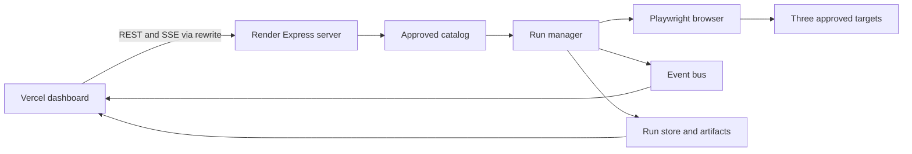

# TestSphere 3D Architecture

Live dashboard: [TestSphere on Vercel](https://testsphere-3d.vercel.app/platform/). See [all flowcharts](WORKFLOWS.md) and the [PNG architecture diagram](assets/architecture-diagram.png).

## Runtime topology



Locally, `server.js` serves both the dashboard and QA Lab, and Playwright opens a visible browser window. In the hosted deployment, Vercel serves `public/`, rewrites `/api/*` to Render, and Playwright runs headlessly. The existing SauceDemo Page Object Model spec files remain available alongside the 90-case dashboard catalog.

## Approved catalog

`execution/catalog.js` is the allowlist. It defines targets, test IDs, safety descriptions, and browser options. A frontend request cannot provide an arbitrary URL, shell command, executable path, or browser argument.

There are **30 cases per target, 90 total**. The three core examples below are in `TESTS`; the remaining 87 are in `ADDITIONAL_TESTS` in `execution/catalog.js`.

| ID | Target | Behavior |
|---|---|---|
| `saucedemo-valid-login` | SauceDemo | Login with the documented standard demo account and assert the Products page |
| `local-cart-total` | My Website (local QA Lab) | Login, add a product, open cart, assert subtotal + tax + shipping |
| `amazon-home-smoke` | Amazon India | Read-only homepage navigation and title/host check |

## Event contract

Events are delivered as SSE messages from:

```text
GET /api/execution/runs/:runId/events
```

Each event contains a monotonically increasing `sequence`, `runId`, `type`, `timestamp`, and event-specific fields. The event bus retains recent events and supports replay with `Last-Event-ID` or `?since=`.

Examples:

```json
{
  "sequence": 4,
  "runId": "run_...",
  "type": "step.finished",
  "kind": "step",
  "name": "assert Local QA cart total arithmetic",
  "status": "passed",
  "timestamp": "2026-10-22T...Z"
}
```

```json
{
  "type": "assertion.failed",
  "name": "cart total equals subtotal plus tax plus shipping",
  "status": "failed",
  "expected": 58.99,
  "actual": 57.99
}
```

## Lifecycle

1. API validates the request against the catalog.
2. `RunStore` creates a queued run record.
3. `RunManager` launches the selected Playwright browser.
4. Explicit adapter steps emit `step.started`, `step.finished`, and `assertion` events.
5. Screenshots and traces are saved under the run's private artifact directory.
6. The UI reconnects to the event stream and can replay events after a temporary disconnect.
7. Stop closes only the managed browser/context for that run.

## Local fault injection

The cart-total fault is disabled by default. When explicitly enabled through the API/UI, `server.js` transforms only the local QA Lab's served `app.js` response. External targets are never transformed. The defect changes the displayed total by a bounded amount so the local Playwright assertion can detect a real mismatch.

Local order submission recalculates the total from the server's product catalog and rejects a mismatched client total. This keeps the defect demonstration meaningful while preventing the demo API from accepting arbitrary totals.

## Evidence strategy

The platform does not claim to provide a full remote desktop. It provides captured browser screenshots tied to real run events, plus trace ZIP files when tracing is enabled. This is reliable on Windows and preserves the separation between the test process and rendering performance.

The execution API also renders a per-run HTML summary from persisted run data. It is a report view, not a fabricated result: steps, assertions, status, duration, errors, and artifact links are read from the same run record used by the UI.
