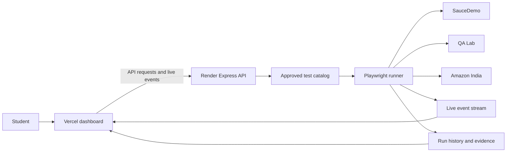

# Test Automation Framework and Live Execution Platform

**Automate. Visualize. Debug.**

## Live deployment links

- TestSphere dashboard: https://testsphere-3d.vercel.app/platform/
- QA Lab storefront: https://testsphere-3d.vercel.app/
- Runner health and test catalog: https://testsphere-3d-runner.onrender.com/api/execution/catalog

## Project flowcharts and workflow links

- Flowcharts and workflows: https://github.com/Himanshu-Damara/TestSphere-3D/blob/main/WORKFLOWS.md
- Architecture: https://github.com/Himanshu-Damara/TestSphere-3D/blob/main/ARCHITECTURE.md
- Deployment guide: https://github.com/Himanshu-Damara/TestSphere-3D/blob/main/DEPLOYMENT.md
- GitHub Actions workflow: https://github.com/Himanshu-Damara/TestSphere-3D/actions/workflows/playwright.yml

The Vercel dashboard currently requires Vercel sign-in. Render's free instance keeps run history only until it restarts or redeploys.

TestSphere 3D turns this Playwright regression project into a controlled, observable testing laboratory. It preserves the original SauceDemo Page Object Model suite and adds an execution API, live server-sent events, evidence artifacts, 30 public Amazon India checks, and a dashboard/laboratory UI.

## How the deployed platform works



Each target has **30 dashboard test cases**, for **90 total**. The flowcharts URL above covers test execution, target flows, deployment, and CI.

## What is working

- Existing SauceDemo regression suite remains in `tests/` and keeps its Page Object Model architecture.
- TestSphere dashboard: `http://localhost:3000/platform/`.
- Light-first responsive UI with a persisted light/dark theme toggle.
- Live Testing Laboratory with real execution timeline, assertions, console output, artifact links, and a CSS 3D/2D flow view.
- Dark execution monitor with one-click launch, live pass/fail/skip/remaining totals, compact per-case statuses and durations. Local tests open in a separate visible browser window; deployed tests run headlessly and provide saved evidence.
- Real Playwright execution for:
  - Thirty SauceDemo dashboard checks for login, home/products, cart, checkout, and logout. Its demo login has no password reset control; the suite records that availability check.
  - Thirty My Website (local QA Lab) checks, including a local demo password reset flow, no-match search, and cart quantity changes.
  - Thirty safe Amazon India checks covering homepage, search, public product details, mobile layout, and the first sign-in step without submitting account details. The runner follows Amazon's “Continue shopping” page when shown. Unavailable pages are shown as skipped.
- Local-only cart-total fault injection for demonstrating a genuine detected defect.
- Local demo registration and isolated mock payment outcomes (approved, declined, invalid, cancelled).
- Server-side local order total validation so the demo does not trust a browser-supplied total.
- Local run history and artifacts under `.testsphere/` (ignored by Git). On restart, interrupted runs are recorded as failed so history does not stay stuck on “running.” Cloud history needs a persistent disk to survive service restarts.
- Per-run HTML summary report at `/api/execution/runs/:runId/report`, with steps, assertions, failures, and evidence links.
- Existing local QA Lab storefront remains available at `http://localhost:3000/`.

## Setup

For cloud hosting, see the deployment guide URL above.

```bash
npm install
npx playwright install
```

## Start TestSphere

On Windows, double-click `launch-dashboard.cmd`. It starts the local server and opens the dashboard.

Alternatively:

```bash
npm start
```

Then open:

- Dashboard and live results: `http://localhost:3000/platform/`
- Local QA Lab application: `http://localhost:3000/`

If port 3000 is occupied by another project, start this app on another port (for example, `$env:PORT='3002'; node server.js` in PowerShell) and open that port's `/platform/` page. The My Website QA Lab target follows the chosen port.

The **My Website** card is connected directly to this local QA Lab. It does not ask for a URL.

## Run checks

```bash
# Original SauceDemo regression suite in visible browser windows locally
npm test

# Focused SauceDemo verification
npx playwright test tests/login.spec.js tests/products.spec.js tests/cart.spec.js tests/checkout.spec.js tests/logout.spec.js --project=chromium

# Local QA Lab suite; server must be running in another terminal
npx playwright test tests/local_qa_lab.spec.js --project=chromium

# TestSphere execution API unit checks
npm run test:backend

# Open the Playwright HTML report
npm run test:report
```

## Project structure

```text
execution/                  Approved catalog, runner, events, history, artifacts, faults, API routes
pages/                      SauceDemo and Automation Exercise Page Objects
tests/                      Regression specs, local QA tests, backend tests
data/users.json             SauceDemo credentials used by the original suite
public/platform/            TestSphere Dashboard + Live Testing Laboratory
public/                     Existing local QA Lab storefront
server.js                   Express app, local store routes, TestSphere API mount
playwright.config.js        Browser projects and Playwright reporting
ARCHITECTURE.md             Runtime design and event contract
WORKFLOWS.md                Execution, testing, deployment, and CI flowcharts
DEPLOYMENT.md               Live URLs, cloud setup, and storage limitations
TESTING_GUIDE.md            How to run and verify scenarios
DEMO_GUIDE.md               Viva/demo walkthrough
```

## Safety model

The execution API accepts a `testId` from an approved catalog, not arbitrary URLs or shell commands. Amazon India checks public browsing pages without submitting account details or placing orders. Fault injection is available only for the local application.

## Known limitations

- Local dashboard runs open a separate visible browser window. The dashboard displays statuses and saved evidence, without embedding the browser. CI runs headlessly because no desktop is available.
- Arbitrary Playwright action-level capture is not inferred from existing tests. The first execution adapters use explicit instrumented steps so expected/actual values are honest.
- Pause/resume is not presented as arbitrary checkpoint restoration. Stop is real process cleanup; future breakpoint support should be implemented as explicit instrumentation.
- Firefox/WebKit depend on locally installed browser binaries and OS support.
- The broader Automation Exercise suite remains a separate external smoke suite and is not part of the approved TestSphere catalog.
