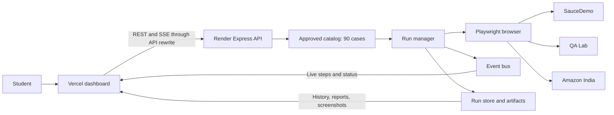
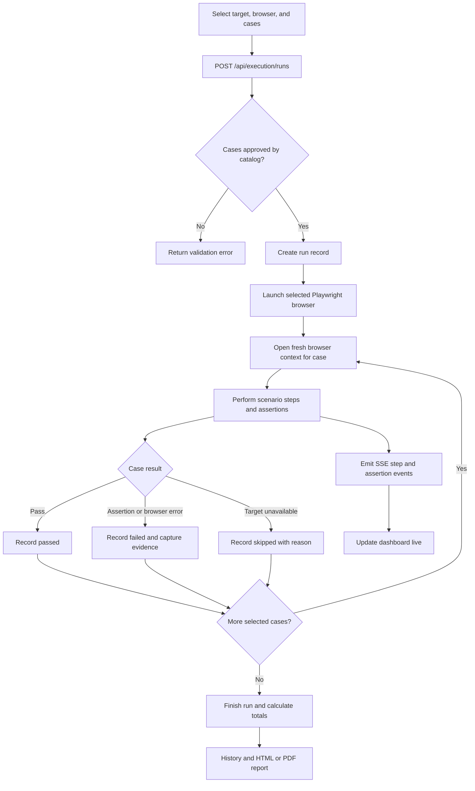
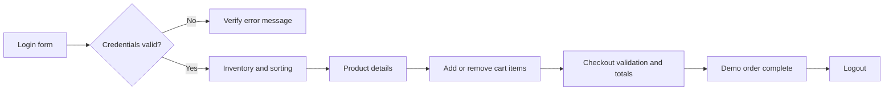
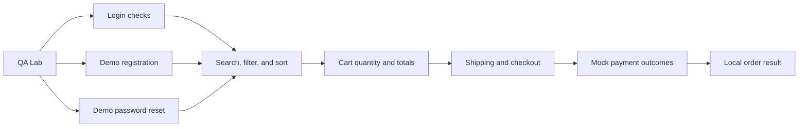
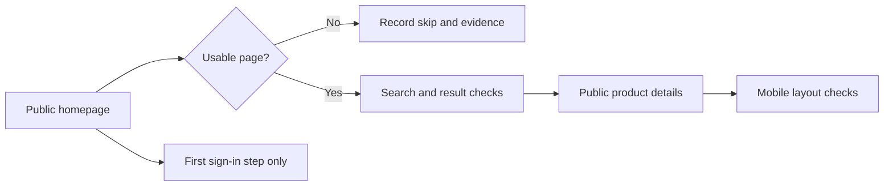
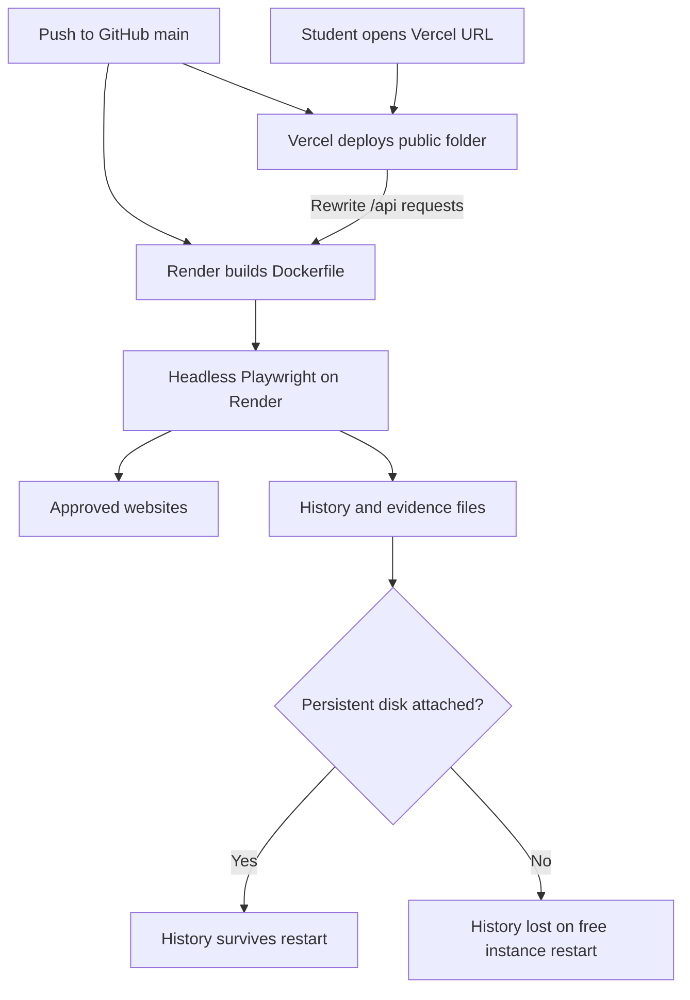

# TestSphere 3D flowcharts and workflows

These Mermaid diagrams render directly on GitHub. The [architecture diagram](assets/architecture-diagram.png) is also available as a PNG for the project report. Its visible-browser label applies to local execution; hosted runs are headless.

## 1. Platform architecture

The dashboard is hosted at [TestSphere on Vercel](https://testsphere-3d.vercel.app/platform/). The runner health endpoint is the [Render catalog](https://testsphere-3d-runner.onrender.com/api/execution/catalog).

## 2. Test execution and result flow

Each case uses a new browser context. The run record, events, and optional screenshots or traces are stored by `execution/store.js`. The dashboard can reconnect to the SSE stream and replay missed events.

## 3. Regression scenarios by target

| Target | Cases | Main modules |
|---|---:|---|
| SauceDemo | 30 | Login validation, inventory, sorting, product details, cart, checkout, logout |
| QA Lab | 30 | Login, registration, demo password reset, search, filters, cart, checkout, mock payment |
| Amazon India | 30 | Public homepage, navigation, search results, product details, mobile view, first sign-in step |

### SauceDemo shopping flow

### QA Lab account and shopping flow

### Amazon India public browsing flow

Amazon cases do not submit credentials, reset a real password, or place an order. Its access checks can be blocked or return incomplete pages, which the run records explicitly.

## 4. Deployment workflow

`vercel.json` defines the API rewrite. `render.yaml` and `Dockerfile` define the runner. Local `npm start` uses a visible browser window; `TESTSPHERE_HEADLESS=true` selects headless mode for cloud hosting. See [deployment details](DEPLOYMENT.md).

## 5. CI workflow

```mermaid
flowchart LR
    Change[Push or pull request] --> Actions[GitHub Actions]
    Actions --> Checkout[Checkout repository]
    Checkout --> Node[Set up Node.js]
    Node --> Install[npm ci]
    Install --> Browsers[Install Playwright browsers]
    Browsers --> Tests[npm test]
    Tests --> Projects[Chromium, Firefox, WebKit]
    Projects --> Report[Upload HTML report artifact]
```

The source is [.github/workflows/playwright.yml](.github/workflows/playwright.yml); view its [GitHub Actions runs](https://github.com/Himanshu-Damara/TestSphere-3D/actions/workflows/playwright.yml). This CI flow runs the Playwright spec files. The dashboard's 90-case catalog is executed separately through the live runner.
